<div align="center">

# Grid-Aware AI Data-Centre Scheduling with Green Hydrogen

**QH2DC** · research software for the ICMLDE 2026 paper *Grid-Connection-Aware Scheduling of AI Data Centres with
Green Hydrogen and Quantum-Assisted Workload Placement* (Paper ID 1939)

[](https://github.com/pavangemmanjunath-cell/Grid-Aware-AI-Datacenter-Scheduling/actions/workflows/ci.yml)
[](LICENSE)


[](https://orcid.org/0000-0002-2694-8807)
[](https://pavangemmanjunath-cell.github.io/Grid-Aware-AI-Datacenter-Scheduling/)

**How small a grid connection can an AI campus live with — and how many megawatts does each resource buy?**

**[▶ Open the live dashboard](https://pavangemmanjunath-cell.github.io/Grid-Aware-AI-Datacenter-Scheduling/)** — runs in your browser, nothing to install

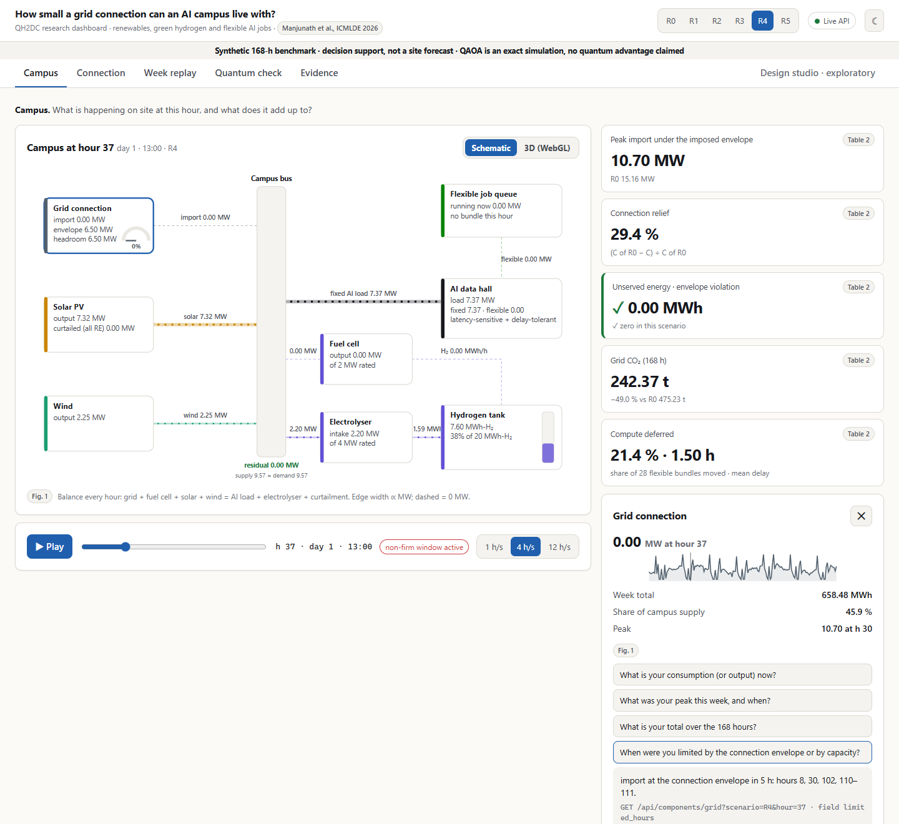

</div>

> [!IMPORTANT]
> **Simulated data — expert review requested.** Every number in this repository comes from a deterministic,
> **synthetic 168-hour benchmark** (seed 20260430), not from any operator, site or company. Results support
> claims about the *mechanism* (which resource relieves which hours), **not** about any real site's megawatts.
> The quantum part is an **exact 12-qubit state-vector simulation** of an instance small enough to enumerate;
> **no quantum advantage is claimed**. Independent review by grid-connection, hydrogen and data-centre
> specialists is explicitly invited — see [Expert review and collaboration](#expert-review-and-collaboration).

### Results at a glance (synthetic benchmark, published table)

| | R0 grid only | R1 + renewables | R2 + green H₂ | **R3 + workload flexibility** | R4 non-firm envelope | R5 phased envelope |
|---|---|---|---|---|---|---|
| Connection (MW) | 15.16 | 12.59 | 10.59 | **8.94 (−41.0 %)** | 10.70 *(peak under envelope)* | 10.62 *(peak under envelope)* |
| Grid CO₂ (t / week) | 475.23 | 249.42 | 242.64 | **242.39** | 242.37 | 242.59 |
| Bundles shifted · mean delay | — | — | — | **10.7 % · 0.46 h** | 21.4 % · 1.50 h | 3.6 % · 0.11 h |
| Envelope violation / unserved energy | 0 | 0 | 0 | **0** | 0 | 0 |

Values from [`data/research_results_gridflex.csv`](data/research_results_gridflex.csv); reproduced by two independent
implementations under test. R2 CO₂ is 242.64 t, the schedule solved at the reported 10.59 MW cap; the manuscript's
242.25 t is the uncapped R2 schedule — see [PAPER_CODE_ALIGNMENT.md](PAPER_CODE_ALIGNMENT.md#5-manuscript-statements-that-differ-from-the-code-for-the-authors-attention). QAOA (one day, 12 qubits, 4,096 states, 81 feasible): feasible probability mass
27.16 % at p = 1 and 67.13 % at p = 2; the most probable feasible state is the exact optimum at both depths.

<table>
<tr>
<td width="72%">

**Quick links** — [Live demo](https://pavangemmanjunath-cell.github.io/Grid-Aware-AI-Datacenter-Scheduling/) · [Run it in one click](#quick-start) · [Dashboard tour](#web-application-demo) ·
[Methodology](docs/methodology.md) · [Data pipeline](docs/data-pipeline.md) · [Data flow](docs/data-flow.md) · [Reproducibility](docs/reproducibility.md) ·
[Quantum layer](docs/quantum.md) · [Related work](docs/related-work.md) · [Limitations](docs/limitations.md) ·
[Paper ↔ code](PAPER_CODE_ALIGNMENT.md) · [Cite](#software-citation)

</td>
<td align="center">
<br>
<sub>Scan to open this repository</sub>
</td>
</tr>
</table>

---

## Contents

[Overview](#overview) · [Research problem](#research-problem) · [Motivation](#research-motivation) ·
[Contributions](#key-contributions) · [How this differs](#how-this-work-differs) ·
[Architecture](#system-architecture) · [Methodology](#methodology) · [Repository structure](#repository-structure) ·
[Installation](#installation) · [Quick start](#quick-start) · [Usage](#usage) · [Web application](#web-application-demo) ·
[Dataset](#dataset) · [Reproducing the research](#reproducing-the-research) · [Benchmarks](#benchmarks) ·
[Tests](#tests) · [Limitations](#known-limitations) · [Paper](#research-paper) · [Citation](#software-citation) ·
[Impact](#research-impact--adoption) · [Expert review](#expert-review-and-collaboration) · [Contributing](#contributing) · [License](#license) · [Authors](#authors-and-contributors)

## Overview

| | |
|---|---|
| **What it does** | Minimises the **required grid connection capacity** of an AI campus (not its energy cost) by co-scheduling grid import, an electrolyser, a hydrogen tank, a fuel cell and the placement of delay-tolerant AI work. |
| **Domain** | Energy systems × AI infrastructure × combinatorial / quantum optimisation |
| **Target problem** | Large AI loads wait years for firm grid connections; non-firm (curtailable) agreements could connect them earlier if the campus can stay inside a time-varying import envelope. |
| **Users** | Energy-systems and data-centre researchers, grid-connection planners, students, reviewers reproducing the paper, quantum-optimisation researchers looking for a verifiable benchmark. |
| **Outputs** | Minimum feasible connection capacity per scenario, hour-by-hour dispatch, envelope compliance, unserved energy, operational CO₂, renewable utilisation, workload deferral, QUBO/QAOA statistics, an interactive 3D web simulator. |

## Research Problem

A data hall can be designed and energised in roughly two years; the substation work and congestion
relief needed to supply it at full power often take longer. The usual answer — a **firm connection
sized to peak demand** — treats the campus as one rigid block of load. Network operators in several
jurisdictions now offer **non-firm** or **phased** connections that grant earlier access in exchange
for periodic import limits.

> **Research question.** How small a grid connection can an AI campus run on — with zero unserved
> energy and every flexible job inside its deadline window — when renewables, a deliberately small
> hydrogen plant and workload flexibility are scheduled together?

The paper asks four questions: how far each resource reduces the required capacity (RQ1); whether a
campus can hold a phased or non-firm envelope with zero unserved energy (RQ2); how much workload
shifting a small hydrogen plant forces (RQ3); and whether a compact QUBO/QAOA recovers the best daily
placement often enough to be a useful quantum test case (RQ4).

## Research Motivation

- Connection capacity, not tariff, is increasingly the binding constraint on new compute campuses.
- Studies of data-centre flexibility usually optimise carbon or cost with the grid limit absent or fixed
  (see [docs/related-work.md](docs/related-work.md) for a dated survey of public repositories and papers).
- Hydrogen buffering and workload shifting act on **different hours** of the week; whether they are
  substitutes or complements has to be measured jointly.
- The only discrete decision — which slot each bundle runs in — is a natural, fully verifiable test
  instance for near-term quantum optimisation.

## Key Contributions

### Scientific contributions
- A formulation that treats **connection capacity as the quantity to minimise**, recovered by
  bisection as the smallest uniform cap for which the schedule remains feasible.
- A sequential decomposition on the benchmark: renewables −2.58 MW, hydrogen −2.00 MW, workload
  flexibility −1.64 MW (15.16 → 8.94 MW, −41.0 %).
- Evidence on this benchmark that the campus can hold a non-firm envelope (6.5 MW for 7 h/day) with zero
  unserved energy by moving 6 of 28 bundles, and that it **cannot** with bundles pinned.

### Algorithmic contributions
- Hourly MILP over grid import, electrolyser, hydrogen inventory, fuel cell, curtailment and one-hot
  bundle placement, with a renewable-backing constraint and a cyclic (anti-gaming) terminal inventory.
- A connection-aware QUBO for the daily placement block (one-hot, connection-stress, carbon,
  renewable-coincidence, deferral and collision terms) and an exact QAOA state-vector simulator.

### Software contributions
- MATLAB reference implementation (`matlab/`) with a toolbox-free fallback scheduler.
- Independent Python/SciPy re-implementation (`verify/verify_python.py`).
- An importable simulation engine + **FastAPI** service (`webapp/backend`) and an animated
  **React / three.js (WebGL)** simulator (`webapp/frontend`).

### Reproducibility contributions
- Deterministic benchmark (fixed seed), shipped as CSV with SHA-256 provenance.
- The published values (produced by the MATLAB MILP run) are reproduced by two independent
  implementations under test: the Python cross-check (64/64) and the web engine (all six scenarios, both
  QAOA depths); a toolbox-free MATLAB run reproduces all six capacities (50/69 checks).
- Documented divergences (fallback solver, QAOA depth-2 optimiser sensitivity) instead of hidden ones.

## How This Work Differs

| Existing approach | Limitation for this question | Approach implemented here | Technical difference |
|---|---|---|---|
| Carbon-/price-aware workload shifting (e.g. Let's Wait Awhile, Riepin–Brown–Zavala) | Grid connection limit absent or fixed; no on-site hydrogen chain | Connection capacity is the optimised quantity; envelope may vary hourly | Capacities are engineering quantities, not cost-weighted proxies |
| Interconnection-capacity planning for AI data centres (Butt, Fatima & Li, arXiv:2608.29359, 2026) | Co-sizes PV and other on-site assets under a budget; no hydrogen chain, no non-firm/phased envelope, no quantum layer | Fixed solar + wind + H₂ plant dispatched under firm, phased and non-firm envelopes, plus a QUBO/QAOA placement layer | Complementary formulation; developed independently |
| Data-centre + power-to-hydrogen dispatch (e.g. Liu et al. 2025) | Objective is energy cost; workload is not moved | Joint hydrogen dispatch **and** discrete workload placement | Separates storage relief from flexibility relief |
| Data-centre co-simulators (e.g. vessim, flexdc-sim) | Simulation or demand-response tracking, no capacity search | MILP + bisection for the minimum feasible connection | Returns the smallest feasible cap with a certificate (feasibility) |
| QUBO/QAOA for power scheduling (unit commitment, market clearing) | Different decision block | QUBO only for the placement block; physics stays classical; checked by enumeration | Quantum layer size scales with bundles per day, not horizon |

No superiority claim is made; the comparison describes problem formulation, not performance. A dated survey
of 6 papers, 5 patents and 21 public repositories is in [docs/related-work.md](docs/related-work.md).

## System Architecture

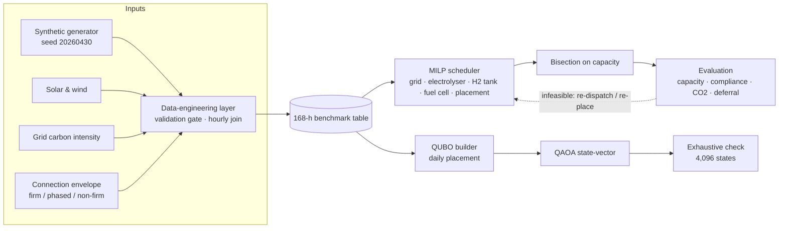

Three implementations of the same model share the `data/` folder: **MATLAB** (`matlab/`, generated the
published results table), **Python/SciPy** (`verify/`, independent cross-check) and the **web engine**
(`webapp/backend/app/engine`, serves the API). Details: [docs/architecture.md](docs/architecture.md);
end-to-end data flow with diagrams: [docs/data-flow.md](docs/data-flow.md).

## Methodology

**Input** (168-h synthetic benchmark) → **preprocessing** (validation gate: `total = fixed + flexible`,
`renewable = solar + wind`) → **model** (hourly MILP with one-hot placement) → **optimisation**
(HiGHS / `intlinprog` / GLPK; bisection on capacity, 24 iterations) → **output** (capacities and
schedules) → **validation** (envelope violation, unserved energy, cross-implementation parity,
exhaustive QUBO enumeration). Full formulation, weights and assumptions: [docs/methodology.md](docs/methodology.md).
How every data file is generated, validated, published, verified and served — and the planned improvements:
[docs/data-pipeline.md](docs/data-pipeline.md).
Why a QUBO/QAOA layer, what is and is not claimed, and framework licences (PennyLane, Qiskit — both
Apache-2.0): [docs/quantum.md](docs/quantum.md).

## Repository Structure

```text
.
├── matlab/                 MATLAB reference implementation (not modified here; generated data/research_results_gridflex.csv)
├── verify/                 independent Python/SciPy cross-check + MATLAB verification harness
├── data/                   synthetic 168-h benchmark, published results, dataset catalogue, data README
├── figures/                gr1–gr6 artwork (PNG/PDF)
├── scripts/                crosscheck.py, export_dispatch.py, export_static_snapshot.py, pennylane_crosscheck.py, qh2dc_reference.py
├── tests/                  unit/ (data + published-number invariants), integration/ (full reproduction)
├── webapp/
│   ├── backend/            FastAPI service + simulation engine + tests (OpenAPI in openapi.json)
│   └── frontend/           React 19 + Vite + React Three Fiber (three.js / WebGL) simulator
├── benchmarks/             recorded toolbox-free MATLAB run, benchmark notes
├── examples/               small runnable examples
├── docs/                   architecture, data flow, methodology, quantum, related work, limitations, ADRs, …
├── START.bat / STOP.bat    one-click start and stop on Windows
└── .github/                CI, issue forms, PR template, Dependabot
```

## Installation

Tested locally on Windows 11 with Python 3.13.5, Node.js 24.20 and MATLAB R2026a. The GitHub Actions
workflow (Ubuntu, Python 3.11/3.12, Node 22) is configured but runs for the first time once the
repository is pushed.

```bash
git clone https://github.com/pavangemmanjunath-cell/Grid-Aware-AI-Datacenter-Scheduling.git
cd Grid-Aware-AI-Datacenter-Scheduling
python -m venv .venv
# Linux/macOS: source .venv/bin/activate      Windows: .venv\Scripts\activate
python -m pip install -r requirements.txt
```

> **Windows:** clone into a short path (e.g. `C:\src\`). Paths longer than 260 characters break
> `npm install` and several Python tools unless *LongPathsEnabled* is set.

## Quick Start

**Windows, one click:** double-click **`START.bat`**. On first run it creates a Python environment,
installs the API and web-app packages (a few minutes), starts the FastAPI service and the web app, and
opens <http://127.0.0.1:5173>. `STOP.bat` stops everything. It also works from very long folder paths
(it maps a temporary drive letter).

**Any OS, command line:**

```bash
python examples/01_inspect_benchmark.py     # < 1 s: what is in the benchmark
python examples/02_qubo_enumeration.py      # ~1 s: 4,096 states, 81 feasible, exact optimum
python scripts/crosscheck.py                # ~25 s: reproduce all 64 published values in Python
```

Expected last line of the cross-check: `64/64 checks passed`.

## Usage

| Task | Command | Output |
|---|---|---|
| Reproduce the paper in MATLAB | `cd matlab` then `main_qh2dc` (MATLAB) | scenario table, `data/research_results_gridflex.csv`, `figures/gr1–gr6` (**overwrites them**) |
| Verify a MATLAB run without overwriting | `cd verify` then `matlab -batch "addpath('../matlab'); qh2dc_verify_run('qh2dc_run_actual.txt')"` then `python verify/check_run.py` | PASS/FAIL table against the shipped reference |
| Python reproduction | `python scripts/crosscheck.py` | 64 comparisons, exit code 0 on success |
| Start everything (Windows) | `START.bat` / `STOP.bat` | browser opens the simulator |
| Start the API | `cd webapp/backend && uvicorn app.main:app --port 8000` | OpenAPI docs at <http://localhost:8000/docs> |
| Start the web app | `cd webapp/frontend && npm ci && npm run dev` | <http://localhost:5173> |
| Export hourly MILP dispatch per scenario | `python scripts/export_dispatch.py` | `data/dispatch/*.csv` |
| Refresh the dashboard's API snapshot | `cd webapp/backend && python -m app.snapshot` | `webapp/frontend/public/api-snapshot/` |
| Refresh the 3D / circuit-explorer snapshot | `python scripts/export_static_snapshot.py` | `webapp/frontend/public/data/qh2dc.json` |
| Gate-level QAOA check in PennyLane (optional) | `pip install -r requirements-quantum.txt` then `python scripts/pennylane_crosscheck.py` | PASS for p = 1 and p = 2 |

## Web Application (Demo)

A research dashboard built with **React 19 + TypeScript + Vite**, a hand-built **SVG component graph**,
**React Three Fiber (three.js / WebGL)** for the optional 3D view, **TanStack Query**, and a **FastAPI**
backend. The front end only reads: every number on screen comes from a versioned, cacheable API endpoint
(`/api/meta`, `/api/scenarios`, `/api/benchmark`, `/api/dispatch`, `/api/jobs`, `/api/qaoa`,
`/api/components`) and carries a citation chip pointing to the paper table or figure and the CSV column.
Scenario, view and hour live in the URL (for example `?view=week&scenario=R4&hour=37`).

| | |
|---|---|
| 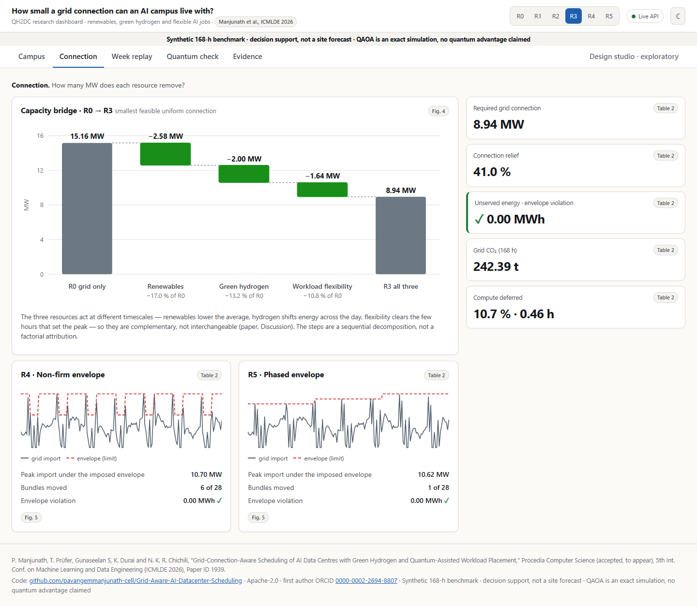<br>**Connection** — capacity bridge R0 → R3 computed from the API; R4/R5 peak import against their envelopes | 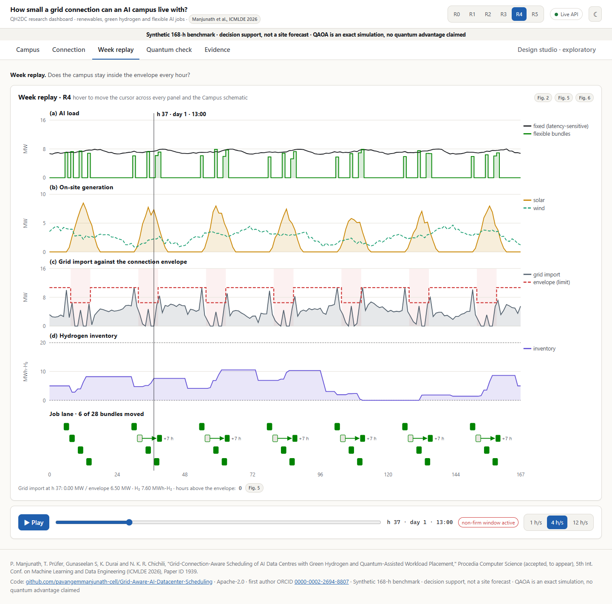<br>**Week replay** — load, generation, import against the envelope, hydrogen inventory and the job lane on one shared axis |
| 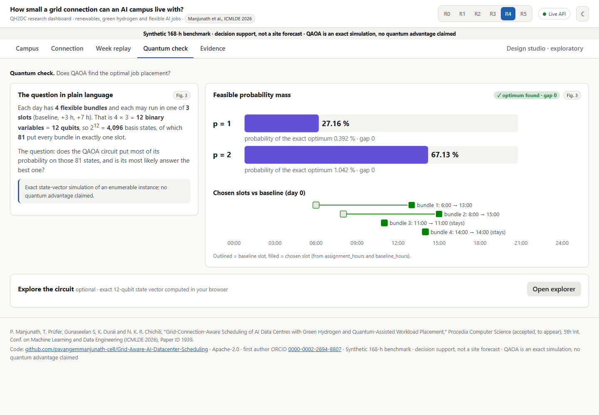<br>**Quantum check** — 12 qubits, 4,096 states, 81 feasible; optimum found, gap 0 | 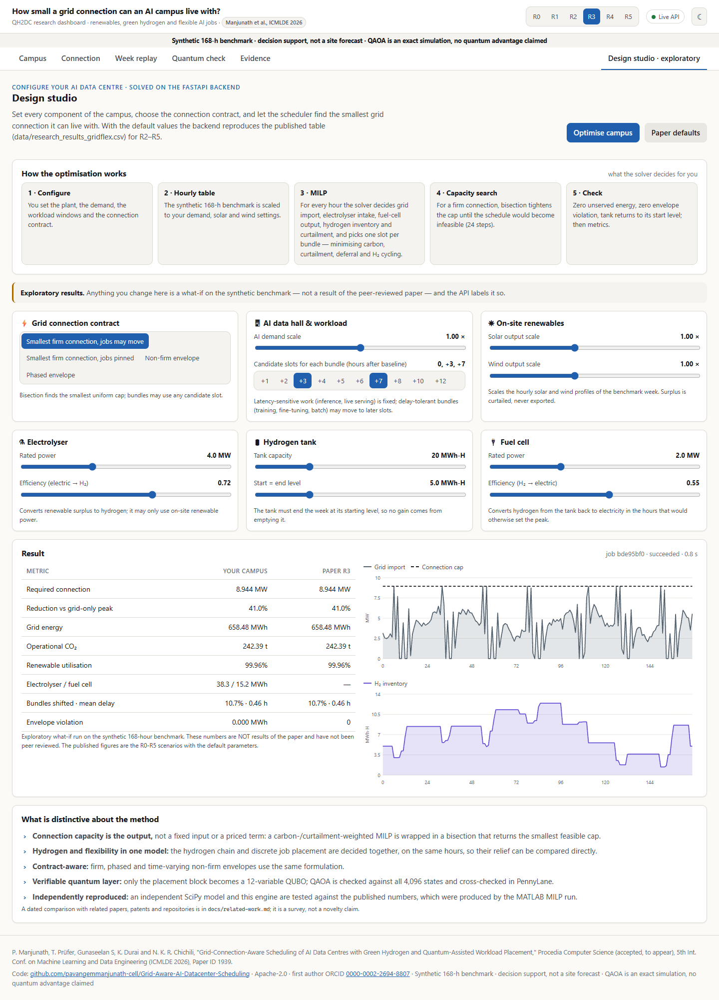<br>**Design studio** *(exploratory)* — configure every component and re-solve; defaults reproduce the published table |
| 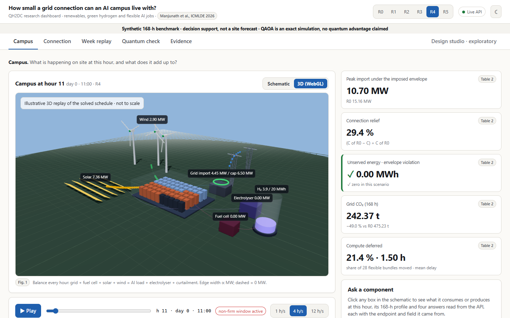<br>**3D view** — optional WebGL replay of the same solved hour (illustrative, not to scale) | 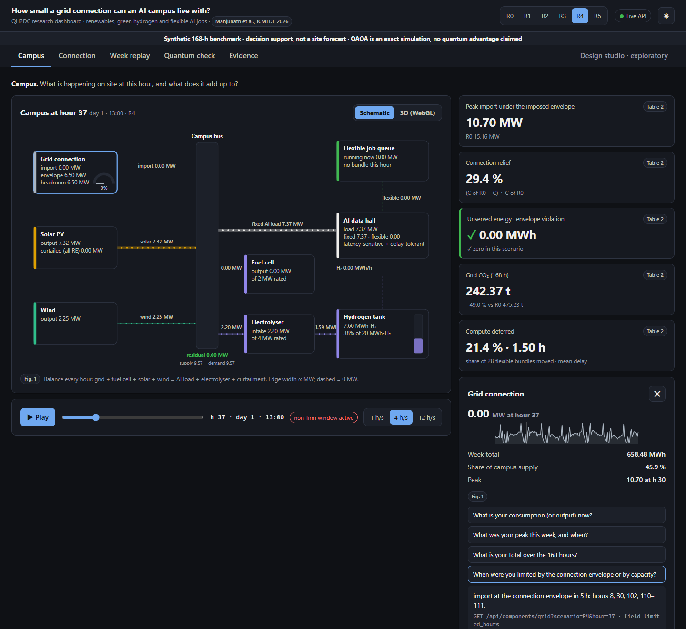<br>**Dark mode** — optional; light “paper” style is the default |

The full Evidence view (method, assumptions, downloads, citation, related work, candidate datasets) is shown in
[assets/screenshots/05-evidence.png](assets/screenshots/05-evidence.png). Details and API contract:
[webapp/README.md](webapp/README.md). Twelve Playwright acceptance tests check the dashboard acceptance checklist
(banner on every view, ≤ 5 KPI cards, citation chips, R4/R5 labelling, URL state, values equal to API fields).

### Simulation figures

Rendered by the MILP reference model from the same data (`scripts/qh2dc_reference.py`); content as in the paper.

| | |
|---|---|
| 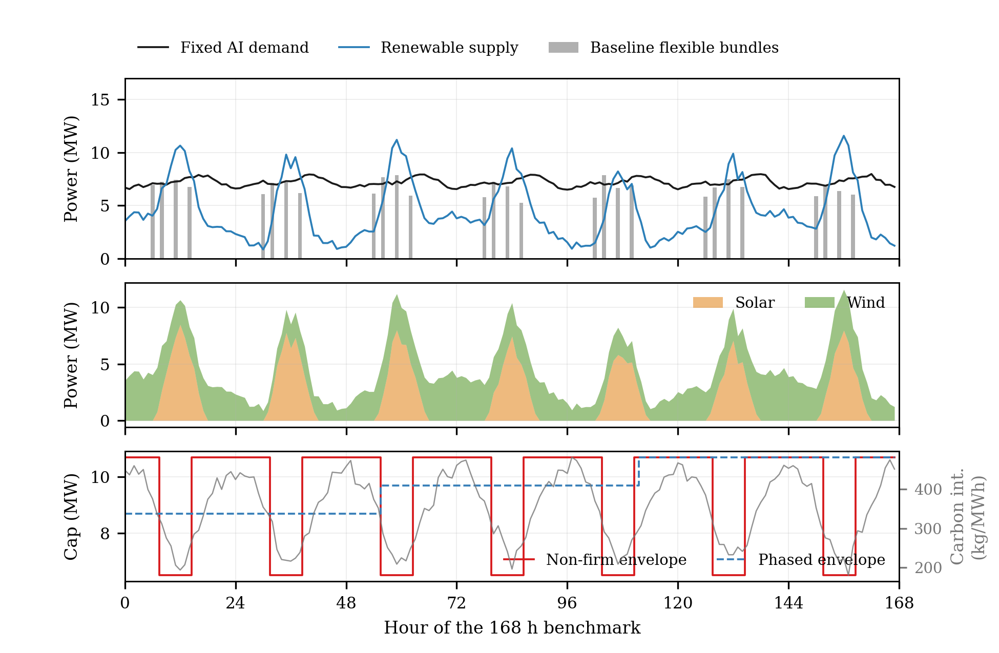<br>**Fig. 2** — the 168-h synthetic benchmark | 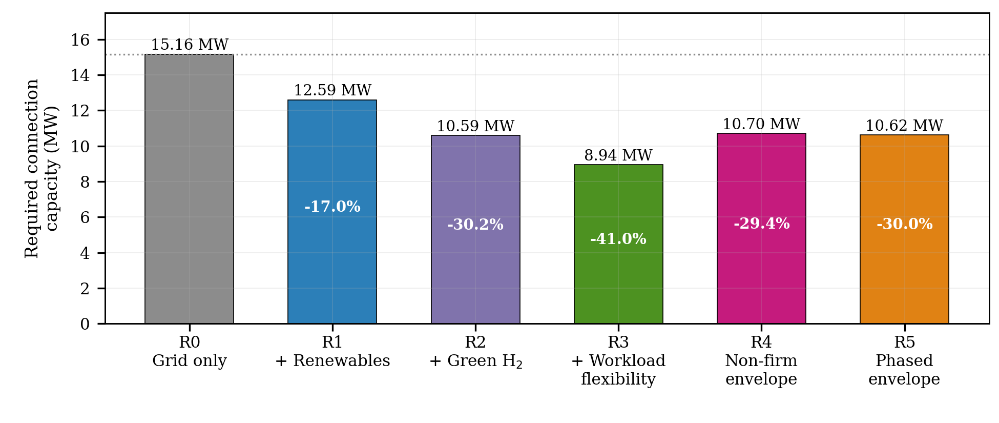<br>**Fig. 4** — required connection capacity, R0–R5 |
| 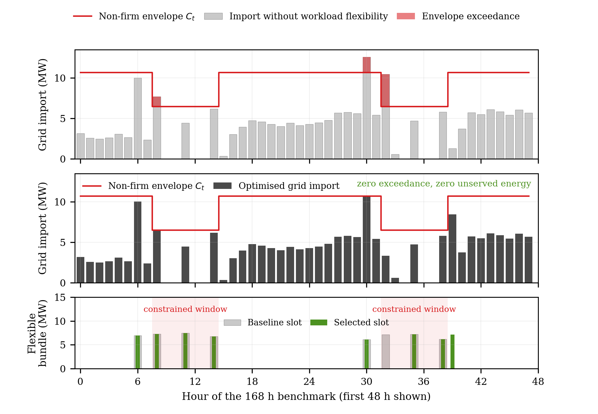<br>**Fig. 5** — non-firm operation, first 48 h | 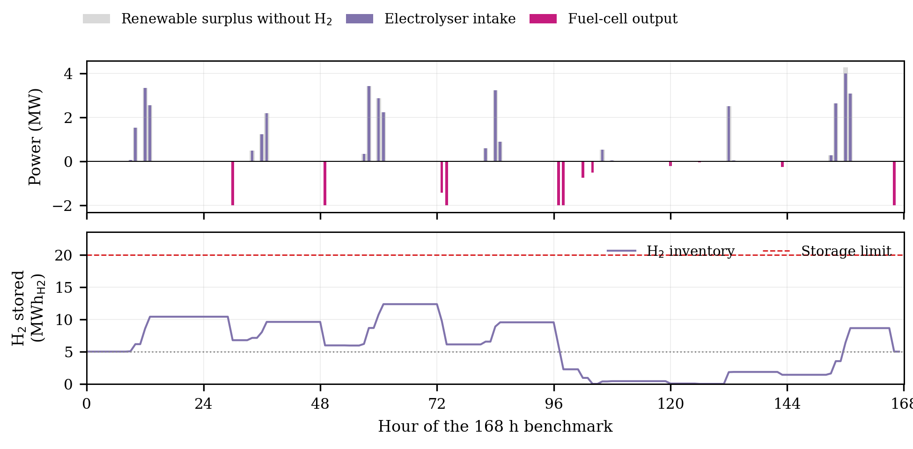<br>**Fig. 6** — hydrogen buffering and tank inventory (R2) |
| 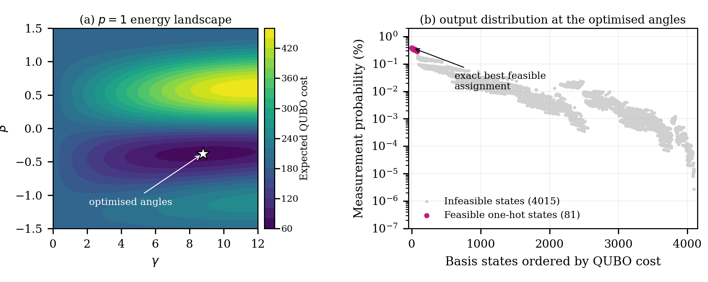<br>**Fig. 3** — QAOA landscape and output distribution | 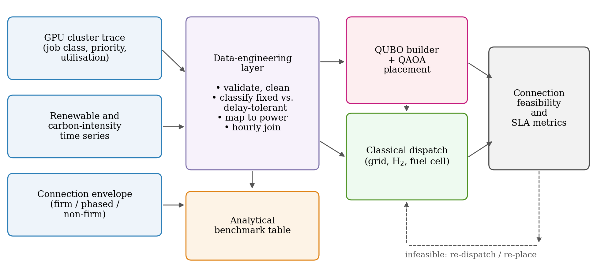<br>**Fig. 1** — conceptual framework (the published run uses the synthetic generator, not a GPU trace) |

## Dataset

| | |
|---|---|
| Name | QH2DC 168-hour benchmark (`data/research_benchmark_168h.csv`) |
| Source | Generated by `matlab/qh2dc_build_benchmark.m`, seed 20260430 |
| Type | **Synthetic / simulated**. Not operator data, not derived from any public dataset |
| Licence | Apache-2.0 (part of this repository) |
| Preprocessing | Validation gate in `qh2dc_load_benchmark.m`; no other transformation |
| Download | Included; nothing to download |

**Connected datasets: none.** The software reads only the synthetic files in `data/` and calls no
external API. Sixteen candidate public sources for a future real-data study (AI workload and GPU-power
traces, PV/wind APIs, carbon-intensity APIs, cost baselines) are listed with their verified licences and
commercial-use terms in [data/README.md](data/README.md#candidate-public-datasets-not-connected).

## Reproducing the Research

1. **Environment** — Python ≥ 3.10 with `requirements.txt`; MATLAB R2021a+ for the reference code
   (Optimization Toolbox for the MILP path; base MATLAB uses the fallback).
2. **Data** — shipped; verify with `python -m pytest tests/unit`.
3. **Configuration** — every parameter lives in `matlab/qh2dc_config.m` (mirrored in the Python code).
4. **Run** — `main_qh2dc` (MATLAB) or `python scripts/crosscheck.py`.
5. **Evaluate** — `python verify/check_run.py` (MATLAB run) or the cross-check's PASS/FAIL table.
6. **Artefacts** — `data/research_results_gridflex.csv`, `data/verification_summary.json`, `figures/gr1–gr6`.
7. **Seeds** — benchmark seed 20260430; QAOA restarts seed 7 (MATLAB legacy generator).

Known divergences (fallback solver, QAOA p = 2 across MATLAB releases) are explained in
[docs/reproducibility.md](docs/reproducibility.md) and [PAPER_CODE_ALIGNMENT.md](PAPER_CODE_ALIGNMENT.md).

## Benchmarks

Formal benchmark suite against external methods is under development. What exists and is verified:

| Method | Data | Environment | Metric | Result | Basis | Date / version |
|---|---|---|---|---|---|---|
| Python/SciPy (HiGHS) reproduction | 168-h benchmark | Windows 11, Python 3.13.5, SciPy 1.15.3 | published values matched | 64 / 64 | `data/` reference files | 2026-11-21, v1.0.0 |
| Web engine parity | 168-h benchmark | same | scenarios + QAOA depths matched | 6 / 6 and 2 / 2 | `data/` reference files | 2026-11-21, v1.0.0 |
| PennyLane gate-level QAOA | day-0 QUBO | PennyLane 0.45.1 `default.qubit` | published QAOA statistics matched | 2 / 2 depths (distribution to 7e-18) | `verification_summary.json` | 2026-11-21 |
| MATLAB toolbox-free fallback | 168-h benchmark | MATLAB R2026a, no Optimization Toolbox | checks passed | 50 / 69 (all 6 capacities exact) | `verify/check_run.py` | 2026-11-21 |

Details and the reasons for the 19 fallback divergences: [benchmarks/README.md](benchmarks/README.md).

## Tests

```bash
python -m pytest                       # repository tests: data invariants, published-number checks, full Python reproduction
cd webapp/backend && python -m pytest  # engine parity with published numbers + API contract
cd webapp/frontend && npm run build    # type-check and production build
cd webapp/frontend && npx playwright test   # 12 dashboard acceptance tests (Windows: PW_CHANNEL=chrome)
```

## Known Limitations

Synthetic single week · hourly resolution · rectangular workload blocks · constant conversion
efficiencies · perfect foresight · no export; the hydrogen tank is the only buffer · ideal noiseless QAOA on an enumerable
instance · sequential (not factorial) attribution. Several analyses described in the manuscript text
(classical baselines, sensitivity, forecast-error, factorial, noise-aware QAOA) are **not part of this
release**. See [docs/limitations.md](docs/limitations.md).

## Independence statement

This is an independent, open-source academic research project accompanying a conference paper. It
contains no proprietary, confidential or company data, does not describe any company's products or
operations, and is not affiliated with, funded by or endorsed by any company. All data in the repository
are synthetic and generated by the code in this repository.

## Research Paper

P. Manjunath, T. Prüfer, Gunaseelan S, K. Durai, N. K. R. Chichili, *"Grid-Connection-Aware Scheduling
of AI Data Centres with Green Hydrogen and Quantum-Assisted Workload Placement"*, accepted at the
International Conference on Machine Learning and Data Engineering (ICMLDE 2026), paper ID 1939.

Publication DOI and proceedings details will be added when the paper is published.

## Software Citation

Cite this repository with the metadata in [CITATION.cff](CITATION.cff) or GitHub's **"Cite this
repository"** button. A software DOI will be issued by Zenodo for the first GitHub release; it is not
shown here until it exists.

## Research Impact & Adoption

Only independently verifiable evidence is recorded, in [docs/research-impact.md](docs/research-impact.md).

- **Independent citations** — No independently verified entries documented yet.
- **Independent forks and extensions** — No independently verified entries documented yet.
- **External contributors** — No independently verified entries documented yet.
- **Academic usage** — No independently verified entries documented yet.
- **Industry usage** — No independently verified entries documented yet.
- **External publications** — No independently verified entries documented yet.
- **Benchmark comparisons** — No independently verified entries documented yet.
- **Conference / workshop demonstrations** — Accepted for presentation at ICMLDE 2026 (authors; not independent).
- **External technical references** — No independently verified entries documented yet.

## Expert review and collaboration

This is an open research artefact built on **simulated data**. It has passed peer review as a conference
paper, but the software and its assumptions have **not** been validated against real sites. To make sure
nobody is misled later, we ask domain experts to review it in the open:

| Expertise | What we would like reviewed |
|---|---|
| Grid connection / DSO-TSO planning | the envelope formulation (firm, phased, non-firm) and the capacity-search interpretation |
| Electrolysers, fuel cells, hydrogen | constant efficiencies, the cyclic tank constraint, the plant sizing |
| Data-centre operations / AI workloads | the two-class workload model and rectangular one-hour bundles |
| Optimisation / quantum computing | the MILP, the bisection, the QUBO penalties and the QAOA evaluation |
| Reproducibility | running `python scripts/crosscheck.py` or the MATLAB harness on another platform |

Please use the **Expert review** or **Reproducibility report** issue forms. Collaboration on the open items in
[ROADMAP.md](ROADMAP.md) — real-data adapters, classical baselines, sensitivity studies, noisy QAOA — is very
welcome. Contributors are credited in [AUTHORS.md](AUTHORS.md) and the release notes; see
[CONTRIBUTING.md](CONTRIBUTING.md) for how authorship is (and is not) decided.

## Contributing

Bug reports, reproducibility studies, benchmark contributions, dataset adapters (where licensing
permits), additional algorithms, independent comparisons and documentation are welcome. Start with
[CONTRIBUTING.md](CONTRIBUTING.md) and the issue forms.

## Roadmap

[ROADMAP.md](ROADMAP.md)

## Security

Please do not report vulnerabilities in public issues — see [SECURITY.md](SECURITY.md).

## Support

[SUPPORT.md](SUPPORT.md)

## License

[Apache License 2.0](LICENSE).

## Authors and Contributors

**Pavan Manjunath** — ORCID [0000-0002-2694-8807](https://orcid.org/0000-0002-2694-8807).
Paper co-authors and contribution roles: [AUTHORS.md](AUTHORS.md).
