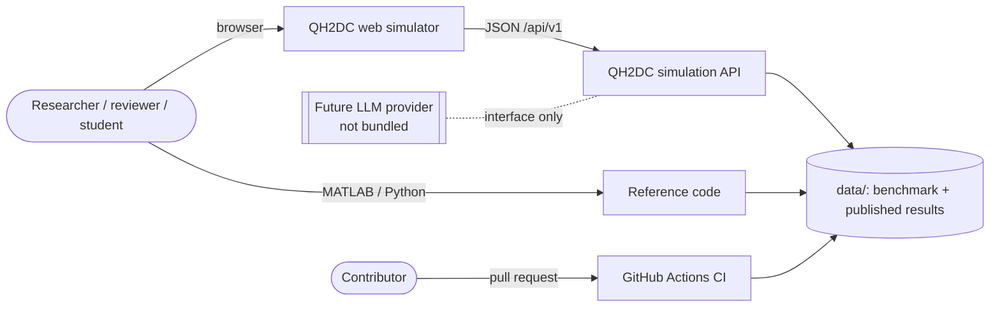
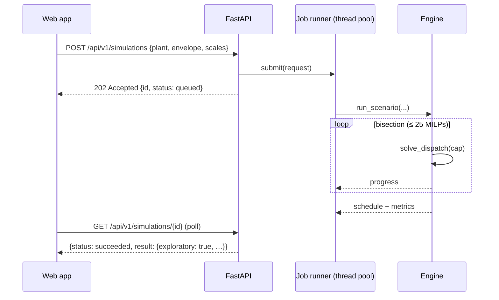

# Architecture

## System context

No external service is called at runtime. The optional language-model assistant is an interface only;
it is disabled and no provider is bundled.

## Major components

| Component | Path | Technology | Responsibility |
|---|---|---|---|
| Reference implementation | `matlab/` | MATLAB (R2021a+), optional Optimization Toolbox | Generated the published results table and figures; not modified in this repository |
| Independent cross-check | `verify/verify_python.py` | Python, SciPy `milp` (HiGHS) | Re-implements the model; replays the MATLAB QAOA angles |
| Verification harness | `verify/qh2dc_verify_run.m`, `verify/check_run.py` | MATLAB + Python | Runs MATLAB without overwriting results; PASS/FAIL against shipped artefacts |
| Reproduction tooling | `scripts/` | Python | Runs the cross-check in a temporary workspace; exports the web snapshot |
| Simulation engine | `webapp/backend/app/engine` | Python, NumPy, SciPy | Importable library: benchmark loader, MILP, bisection, QUBO, QAOA |
| Simulation API | `webapp/backend/app` | FastAPI, Pydantic v2, Uvicorn | REST API v1, async what-if jobs, provenance, LLM extension point |
| Web simulator | `webapp/frontend` | React 19, Vite, React Three Fiber / three.js, zustand, motion | Animated 3D replay, charts, quantum lab, Design studio |
| Quality gates | `tests/`, `webapp/backend/tests`, `.github/workflows` | pytest, TypeScript, GitHub Actions | Data invariants, published-number consistency, parity, API contract, build |

## Data flow

1. `research_benchmark_168h.csv` is read and validated (identical gate in all three implementations).
2. The scheduler solves each scenario; for R2/R3 the bisection calls it up to 25 times.
3. Published artefacts (`research_results_gridflex.csv`, `verification_summary.json`) are produced by the
   MATLAB run and the Python cross-check.
4. The API solves R0–R5 once per process (≈1–2 s), caches the schedules, and serves them.
5. `scripts/export_static_snapshot.py` writes the same schedules plus the QAOA landscape into
   `webapp/frontend/public/data/qh2dc.json`, so the front end also works without a backend.
6. The front end replays schedules in 3D, computes the QAOA state vector locally, and posts what-if jobs
   to the API.

## Model / algorithm flow

## Interfaces

- **REST API v1** — documented in `webapp/backend/openapi.json` and live at `/docs`. Endpoints: health,
  provenance, benchmark, datasets, scenarios, scenario detail, simulations (create/list/get), quantum
  problem/evaluate/optimise, assistant status/ask.
- **Files** — CSV/JSON in `data/`; figures in `figures/`.
- **MATLAB** — `main_qh2dc` entry point; `qh2dc_verify_run(outfile)` harness.

## Data persistence

No database. Inputs and published results are versioned files in `data/`. What-if jobs are kept in an
in-memory, bounded store (`QH2DC_MAX_JOBS_RETAINED`, default 100) and are lost on restart by design.

## Dependencies

Python: NumPy, SciPy (HiGHS via `milp`), pandas, FastAPI, Pydantic, pydantic-settings, Uvicorn;
matplotlib for figure rendering in `verify/`. JavaScript: React, three.js, @react-three/fiber,
@react-three/drei, zustand, motion; Vite and TypeScript for the build. All are permissively licensed
(MIT / BSD / Apache-2.0); see [../README.md](../README.md#license).

## Deployment / execution model

| Mode | How | Notes |
|---|---|---|
| Local research | MATLAB or Python scripts | no network required |
| Local web app | `uvicorn` + `npm run dev` (Vite proxies `/api`) | tested |
| Static site | `npm run build` → `webapp/frontend/dist` | works without backend (live features disabled) |
| Containers | `docker compose up --build` | Dockerfiles provided; **not yet validated** (Docker daemon was unavailable when this release was prepared) |

Configuration follows 12-factor style: `QH2DC_DATA_DIR`, `QH2DC_CORS_ORIGINS`, `QH2DC_MAX_WORKERS`,
`QH2DC_MAX_JOBS_RETAINED`, `QH2DC_LLM_PROVIDER`.

## Architecture diagram (containers)

See the system-context diagram above and the end-to-end diagrams in [data-flow.md](data-flow.md).

## Design decisions

Recorded as ADRs in [adr/](adr/):

1. [ADR-0001](adr/0001-reference-code-immutable.md) — the published reference code is immutable; new
   capability lives in separate, parity-tested modules.
2. [ADR-0002](adr/0002-browser-replays-solved-schedules.md) — the browser replays solved schedules; only
   the exact 12-qubit QAOA is computed client-side.
3. [ADR-0003](adr/0003-async-what-if-jobs.md) — what-if runs are asynchronous jobs.
4. [ADR-0004](adr/0004-llm-behind-interface.md) — the language-model assistant sits behind an interface
   and is disabled until a provider is reviewed.

## Known architectural limitations

- Three implementations of one model must be kept in step; the parity tests are the guard.
- The job store is per-process and in memory; horizontal scaling needs an external queue.
- The 3D scene is a visual replay, not a physical simulation; layout and scales are illustrative.
- The static snapshot must be regenerated (`scripts/export_static_snapshot.py`) when data change; CI
  checks that it matches the published table.
