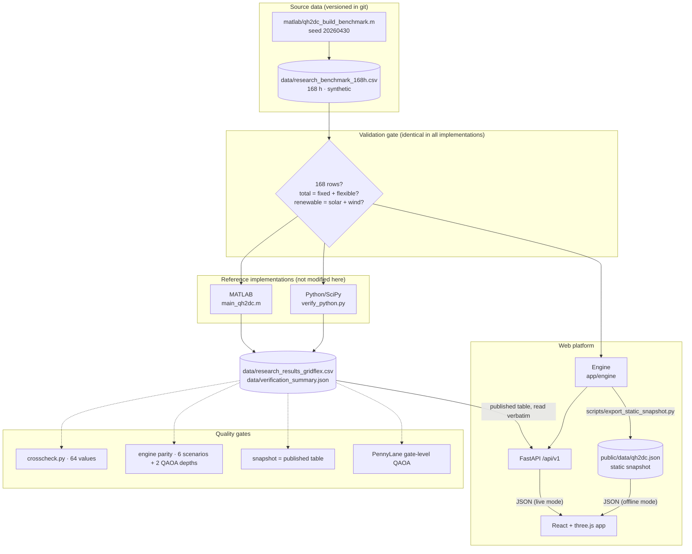
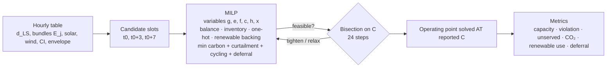
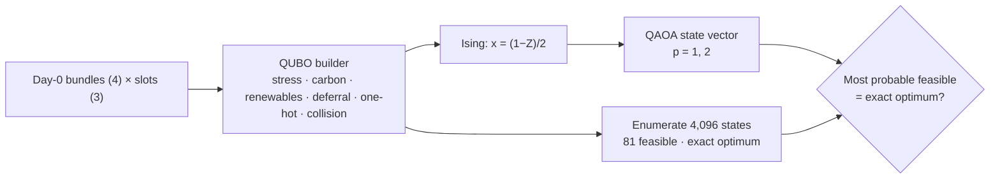
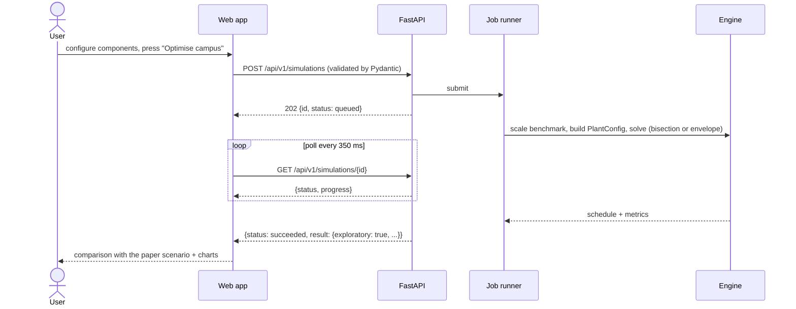
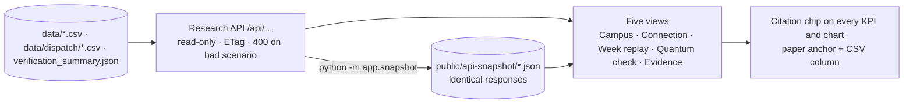

# Data flow

How data moves from the benchmark file to every number on screen. All diagrams are Mermaid and render on
GitHub.

## 1. End to end

## 2. Inside one scheduling run

## 3. Quantum placement branch

## 4. Web request flow (Design studio)

## 5. Dashboard read path

## 6. What leaves the machine

Nothing. No component calls an external service at runtime. The public datasets in
[data/README.md](../data/README.md) are **not connected**; they are listed as candidate sources for a
future real-data study. The language-model interface is disabled.
