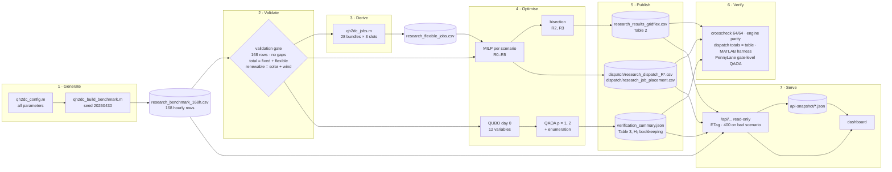

# Data pipeline — how the data is prepared, and what comes next

This page explains, step by step, how every file behind the paper and the dashboard is produced, which code
produces it, how each step is checked, and which improvements are planned. All data are **synthetic**: no
step reads operator, site, customer or company data, and no step calls an external service.

## Overview



## Step by step

### 1 · Generate the benchmark week

| | |
|---|---|
| Code | `matlab/qh2dc_build_benchmark.m`, parameters in `matlab/qh2dc_config.m` |
| Input | none (seeded random processes; `cfg.rng_seed = 20260430`) |
| Output | `data/research_benchmark_168h.csv` — 168 rows × 13 columns |
| What happens | latency-sensitive AI demand (diurnal ripple + noise); four delay-tolerant bundles per day at 06, 08, 11 and 14 h; solar from a clear-sky shape × cloud factor (amplitude 8.6 MW); wind from an AR(1) process bounded to 0.3–5.0 MW; grid carbon intensity anti-correlated with solar; the non-firm (10.7 / 6.5 MW, 08–14 h) and phased (8.7 → 9.7 → 10.7 MW) envelopes |
| Check | `tests/unit/test_benchmark_data.py` (schema, ranges, envelopes, bundle hours) |

Formulas and rationale for each signal: [data/README.md](../data/README.md#how-each-signal-is-generated).

### 2 · Validate (the data-quality gate)

Every implementation runs the same gate before using the file: exactly 168 hourly rows, no missing values,
`total_baseline = fixed + flexible`, `renewable = solar + wind`. A failure stops the run with a readable error
(`qh2dc_load_benchmark.m`, `webapp/backend/app/engine/benchmark.py`).

### 3 · Derive the flexible-job table

`qh2dc_jobs.m` (and `verify_python.py`) turn every non-zero flexible hour into a bundle with energy `E_j` and three
candidate slots: baseline, +3 h and +7 h (clipped to the horizon). Output: `data/research_flexible_jobs.csv`
(28 rows). Check: candidates and energies equal the benchmark (`test_bundle_table`).

### 4 · Optimise

* **MILP per scenario** — grid import, electrolyser, fuel cell, curtailment and hydrogen inventory every hour,
  plus one slot per bundle; objective weights carbon, curtailment, hydrogen cycling and deferral (no price).
  R0 is computed directly (import = demand); R1 has no cap; R4 and R5 use their envelopes.
* **Bisection** (R2, R3) — 24 halvings of [0, 16] MW find the smallest uniform cap that stays feasible; the
  reported metrics are taken from the schedule solved **at** that cap.
* **QUBO / QAOA** — the day-0 placement (4 bundles × 3 slots) becomes a 12-variable QUBO; all 4,096 states are
  enumerated (81 feasible) and the QAOA state vector is evaluated at p = 1 and p = 2.

Solvers: MATLAB `intlinprog` (published table), SciPy `milp` / HiGHS (independent reference and hourly files).

### 5 · Publish the artefacts

| File | Produced by | Content |
|---|---|---|
| `research_results_gridflex.csv` | `matlab/main_qh2dc.m` | Table 2: eight metrics × six scenarios |
| `verification_summary.json` | `verify/verify_python.py` | QAOA statistics, QUBO enumeration, hydrogen bookkeeping |
| `dispatch/research_dispatch_<R>.csv` | `scripts/export_dispatch.py` | 168 hourly decisions per scenario |
| `dispatch/research_job_placement.csv` | `scripts/export_dispatch.py` | chosen slot of every bundle in every scenario |

### 6 · Verify

| Check | Command | Result (2026-11-21) |
|---|---|---|
| Independent Python reproduction of every published value | `python scripts/crosscheck.py` | 64 / 64 |
| Hourly files add up to the published table; bus balances every hour | `python -m pytest tests/unit/test_dispatch_files.py` | pass |
| Web engine reproduces all scenarios and QAOA depths | `cd webapp/backend && python -m pytest` | pass |
| Gate-level QAOA in PennyLane | `python scripts/pennylane_crosscheck.py` | pass (p = 1, 2) |
| MATLAB toolbox-free run vs reference | `qh2dc_verify_run` + `verify/check_run.py` | 50 / 69 (all capacities exact; documented differences) |

### 7 · Serve

`webapp/backend/app/api/research.py` reads only these files and serves them read-only under `/api/...`
(versioned ETag, one-day cache, 400 for an invalid scenario). `python -m app.snapshot` stores the exact API
responses in `webapp/frontend/public/api-snapshot/`, so the dashboard shows identical numbers with or without a
running backend. CI fails if the snapshot or the OpenAPI document is out of date.

### Re-run the whole pipeline

```bash
# 1-5  MATLAB reference (overwrites the published CSV and figures) - or the Python reference below
cd matlab && matlab -batch main_qh2dc && cd ..
# 4-5  hourly dispatch and job placement from the reference MILP
python scripts/export_dispatch.py
# 6    verification
python scripts/crosscheck.py && python -m pytest
# 7    API snapshot and 3D / circuit-explorer snapshot
cd webapp/backend && python -m app.snapshot && cd ../..
python scripts/export_static_snapshot.py
```

Changing the seed or any parameter produces a different week and different published numbers; release such a
change as a new version.

## Future improvements

Ordered by what most strengthens the evidence. None of these is done in this release (items 11–12 have
scaffolding that is not yet validated).

### Data

1. **Real-data adapters** (*Proposed*). Download-and-convert scripts that build the same 168-h table from public
   sources, with licence checks: AI workload and GPU power (e.g. Microsoft Philly traces, CC BY 4.0; the NLR/NREL
   generative-AI power profiles, CC BY 4.0), PV via PVGIS, grid carbon intensity via the NESO API (CC BY 4.0).
   Non-commercial sources (Renewables.ninja, MIT Supercloud) only for academic use. See
   [data/README.md](../data/README.md#candidate-public-datasets-not-connected).
2. **A tested ingestion path** — a fixture and smoke test for `matlab/qh2dc_ingest_trace.m`, and a Python
   equivalent with schema mapping and unit conversion (utilisation → MW).
3. **Many weeks, not one** — a seasonal set of weeks (and several seeds) so results are reported as
   distributions rather than single values.
4. **Sub-hourly resolution** (15 min) to check that short peaks do not breach a non-firm envelope.
5. **Data contracts and lineage** — a machine-readable schema (e.g. JSON Schema / Frictionless) for every file and
   a lineage manifest (input hashes → output hashes) written by each step.

### Model and analysis

6. Classical baselines under identical conditions (earliest-admissible, greedy renewable- and carbon-aware,
   simulated annealing) with runtime and solution quality.
7. Factorial / marginal-contribution attribution of renewables, hydrogen and flexibility.
8. Sensitivity of the envelope (depth, duration, deadline windows) and forecast-error / rolling-horizon operation.
9. Detailed electrolyser and fuel-cell models (part load, ramp limits, minimum load, degradation).
10. QAOA with several initialisations and optimisers, noise models and N × K scaling; real-hardware runs.

### Software and operations

11. Pin the depth-2 QAOA angles in the MATLAB path.
12. Validate the existing manual MATLAB (`matlab.yml`) and Pages (`pages.yml`) workflows on GitHub; validate the
    Docker images.
13. A grounded language-model assistant behind the existing interface (read-only, cites endpoint and field).
14. Independent expert review and reproduction reports (issue forms provided).

These items are tracked in [ROADMAP.md](../ROADMAP.md); contributions are welcome
([CONTRIBUTING.md](../CONTRIBUTING.md)).
