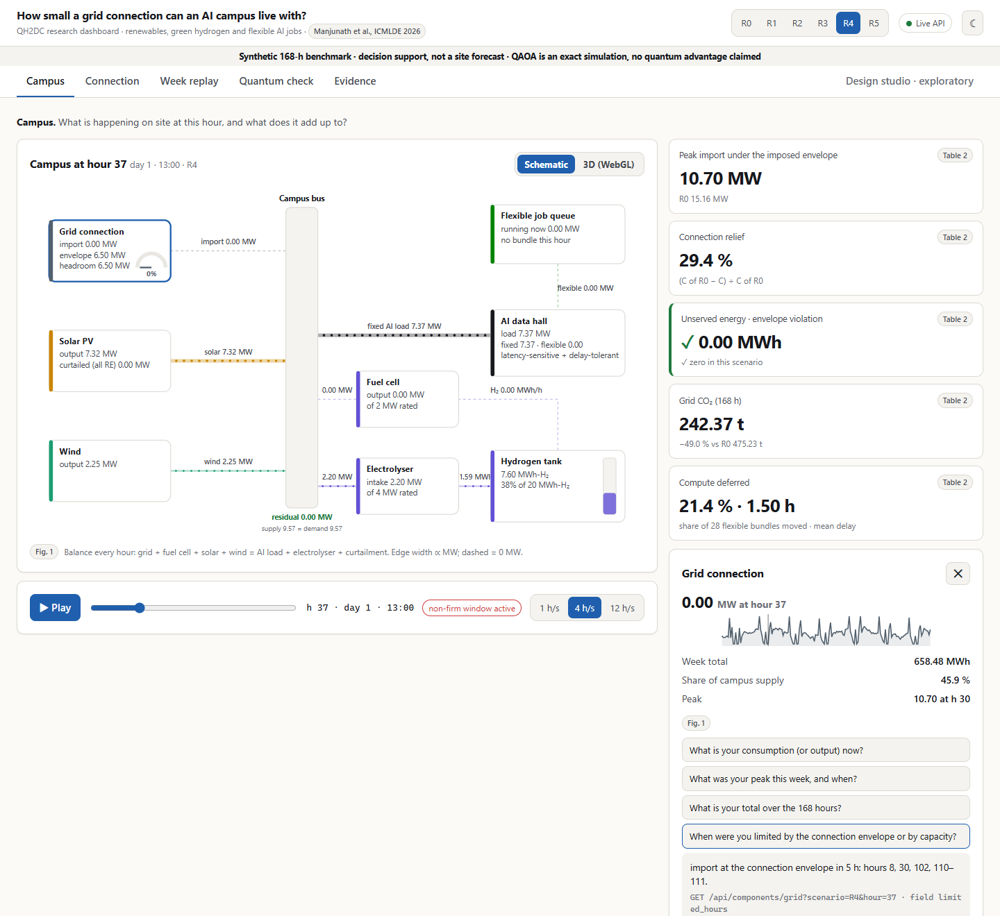
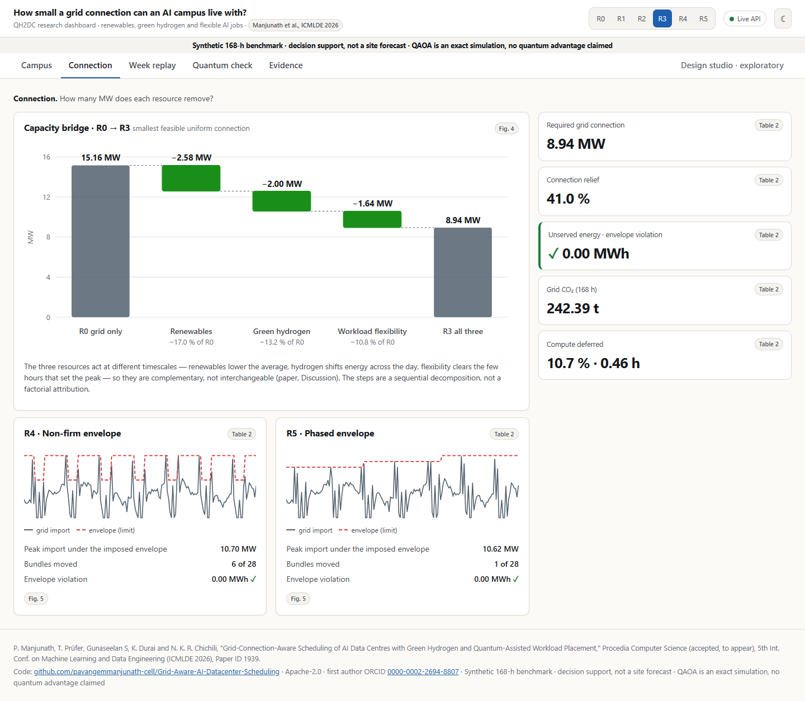
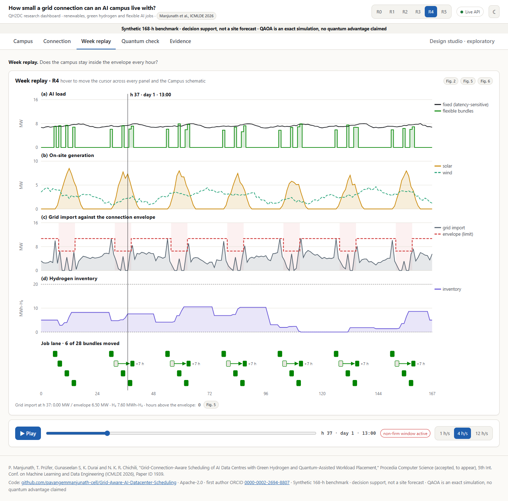
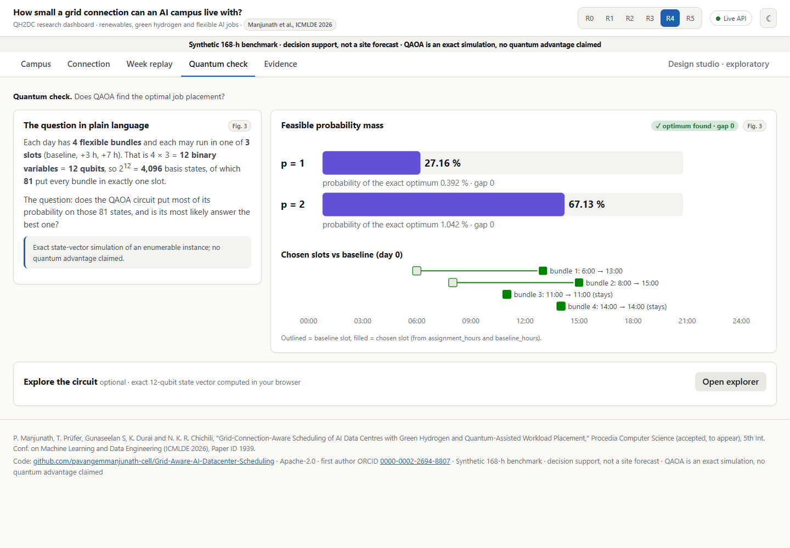

# QH2DC v1.0.0 — Grid-Aware AI Data-Centre Scheduling with Green Hydrogen

**First public release** of the research software for the ICMLDE 2026 paper *Grid-Connection-Aware Scheduling of
AI Data Centres with Green Hydrogen and Quantum-Assisted Workload Placement* (Paper ID 1939; accepted, proceedings
to appear in Procedia Computer Science).

> [!IMPORTANT]
> **Simulated data — expert review invited.** All results come from a deterministic, synthetic 168-hour benchmark
> (seed 20260430). They describe the *mechanism*, not any real site. The QAOA is an exact 12-qubit state-vector
> simulation; **no quantum advantage is claimed**.



## Overview

How small a grid connection can an AI campus live with — and how many megawatts does each resource buy? This
release computes the smallest feasible grid connection when on-site solar and wind, a deliberately small
electrolyser → hydrogen tank → fuel-cell chain and shiftable AI workloads are scheduled together under firm,
phased and non-firm connection envelopes.

## Highlights

| | R0 grid only | R1 + renewables | R2 + green H₂ | **R3 + workload flexibility** | R4 non-firm | R5 phased |
|---|---|---|---|---|---|---|
| Connection (MW) | 15.16 | 12.59 | 10.59 | **8.94 (−41.0 %)** | 10.70 *(peak under envelope)* | 10.62 *(peak under envelope)* |
| Grid CO₂ (t / week) | 475.23 | 249.42 | 242.64 | **242.39** | 242.37 | 242.59 |
| Bundles shifted · mean delay | — | — | — | **10.7 % · 0.46 h** | 21.4 % · 1.50 h | 3.6 % · 0.11 h |
| Envelope violation | 0 | 0 | 0 | **0** | 0 | 0 |

- **Relief by resource (sequential):** renewables −2.58 MW, green hydrogen −2.00 MW, workload flexibility −1.64 MW.
- **Non-firm envelope** (6.5 MW for hours 08–14 every day) held with zero unserved energy by moving 6 of 28 bundles;
  infeasible with bundles pinned.
- **Quantum check:** 12 qubits, 4,096 states, 81 feasible; feasible probability mass 27.16 % (p = 1) and 67.13 %
  (p = 2); the most probable feasible state is the exact optimum at both depths.

## New features

- **MATLAB reference implementation** (`matlab/`) and verification harness (`verify/`) — unchanged from the run that
  produced the published table.
- **Independent Python/SciPy model** reproducing every published value (`scripts/crosscheck.py`).
- **Hourly MILP dispatch** for all six scenarios and the chosen slot of every job (`data/dispatch/`).
- **Research dashboard** — React 19 · TypeScript · Vite · SVG component graph · optional three.js/WebGL view:
  Campus, Connection, Week replay, Quantum check and Evidence views; every number carries a citation chip to the
  paper table/figure and its CSV column; shareable URL state; light theme with optional dark mode.
- **Design studio** *(exploratory)* — configure every component (AI demand, job windows, solar, wind,
  electrolyser, tank, fuel cell, connection contract) and re-solve on the API; defaults reproduce the published
  table.
- **FastAPI backend** — read-only research API (`/api/meta`, `/api/scenarios`, `/api/benchmark`, `/api/dispatch`,
  `/api/jobs`, `/api/qaoa`, `/api/components`) with ETag caching, plus an exploratory `/api/v1` with asynchronous
  what-if jobs.
- **One-click start on Windows** — `START.bat` / `STOP.bat`.
- **Optional gate-level QAOA cross-check in PennyLane** (Apache-2.0).

| Connection | Week replay | Quantum check |
|---|---|---|
|  |  |  |

## Reproducibility

| Check | Command | Result |
|---|---|---|
| Independent reproduction of every published value | `python scripts/crosscheck.py` | 64 / 64 |
| Repository tests (data, published numbers, hourly files) | `python -m pytest` | 31 passed |
| Engine parity + API contract | `cd webapp/backend && python -m pytest` | 42 passed |
| Dashboard acceptance checklist | `cd webapp/frontend && npx playwright test` | 12 passed |
| Gate-level QAOA (PennyLane) | `python scripts/pennylane_crosscheck.py` | pass at p = 1 and p = 2 |
| MATLAB R2026a, toolbox-free path | `qh2dc_verify_run` + `verify/check_run.py` | all six capacities exact (50 / 69 checks; differences documented) |

All checks run in GitHub Actions on every push (Python 3.11 and 3.12, Node 22).

## Quick start

```bash
git clone https://github.com/pavangemmanjunath-cell/Grid-Aware-AI-Datacenter-Scheduling.git
cd Grid-Aware-AI-Datacenter-Scheduling
python -m pip install -r requirements.txt
python scripts/crosscheck.py          # ~25 s, expect "64/64 checks passed"
```

On Windows, double-click **`START.bat`** to install and open the dashboard. Clone into a short path (e.g. `C:\src\`).

## Known limitations

One synthetic week · hourly resolution · rectangular one-hour job bundles · constant conversion efficiencies ·
perfect foresight · the hydrogen tank is the only buffer · sequential (not factorial) attribution · ideal noiseless
QAOA on an enumerable instance. Analyses mentioned in the manuscript text but **not** included: classical
baselines, sensitivity and forecast-error studies, factorial attribution, noise-aware QAOA. Several manuscript
statements differ from the data files (R2 CO₂ 242.64 t in data vs 242.25 t in the text, Table 1 solar/wind sizes,
hydrogen peak, curtailment timing, p = 2 wording) — see
[PAPER_CODE_ALIGNMENT.md](https://github.com/pavangemmanjunath-cell/Grid-Aware-AI-Datacenter-Scheduling/blob/v1.0.0/PAPER_CODE_ALIGNMENT.md).

## Documentation

[README](https://github.com/pavangemmanjunath-cell/Grid-Aware-AI-Datacenter-Scheduling/blob/v1.0.0/README.md) ·
[Data pipeline](https://github.com/pavangemmanjunath-cell/Grid-Aware-AI-Datacenter-Scheduling/blob/v1.0.0/docs/data-pipeline.md) ·
[Methodology](https://github.com/pavangemmanjunath-cell/Grid-Aware-AI-Datacenter-Scheduling/blob/v1.0.0/docs/methodology.md) ·
[Reproducibility](https://github.com/pavangemmanjunath-cell/Grid-Aware-AI-Datacenter-Scheduling/blob/v1.0.0/docs/reproducibility.md) ·
[Quantum layer](https://github.com/pavangemmanjunath-cell/Grid-Aware-AI-Datacenter-Scheduling/blob/v1.0.0/docs/quantum.md) ·
[Related work](https://github.com/pavangemmanjunath-cell/Grid-Aware-AI-Datacenter-Scheduling/blob/v1.0.0/docs/related-work.md) ·
[Limitations](https://github.com/pavangemmanjunath-cell/Grid-Aware-AI-Datacenter-Scheduling/blob/v1.0.0/docs/limitations.md) ·
[Dashboard & API](https://github.com/pavangemmanjunath-cell/Grid-Aware-AI-Datacenter-Scheduling/blob/v1.0.0/webapp/README.md)

## Expert review and collaboration

Independent review by grid-connection, hydrogen, data-centre, optimisation and quantum specialists is explicitly
invited — please use the **Expert review** or **Reproducibility report** issue forms. Contributions to the
roadmap (real-data adapters, classical baselines, sensitivity studies) are welcome; see
[CONTRIBUTING.md](https://github.com/pavangemmanjunath-cell/Grid-Aware-AI-Datacenter-Scheduling/blob/v1.0.0/CONTRIBUTING.md).

## Citation

Cite the software with **“Cite this repository”** (from `CITATION.cff`). The Zenodo software DOI for this release is
added to the README once Zenodo has archived it. Paper DOI: not yet available.

## Contributors

Pavan Manjunath — [ORCID 0000-0002-2694-8807](https://orcid.org/0000-0002-2694-8807).
Paper co-authors: Thomas Prüfer, Gunaseelan S, Karthiganesh Durai, Naveen Kumar Reddy Chichili.

## License

Apache-2.0. The data are synthetic and generated by the code in this repository.
