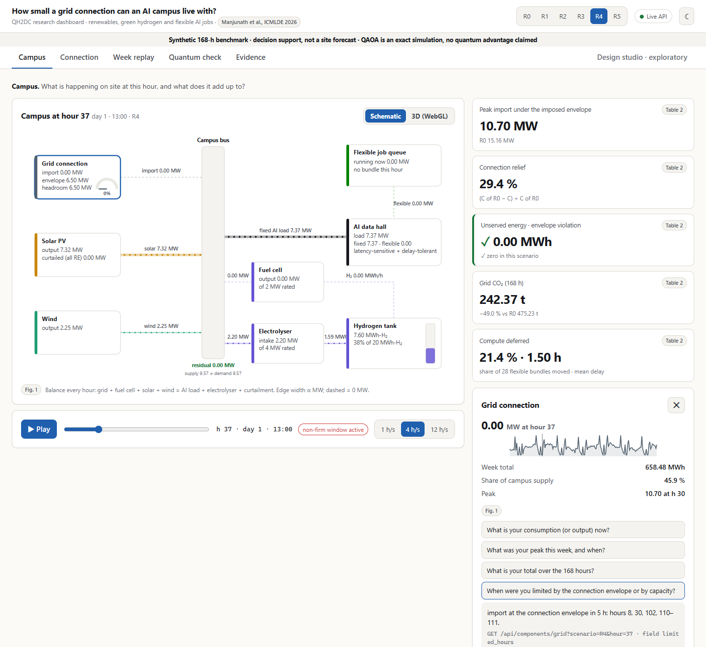
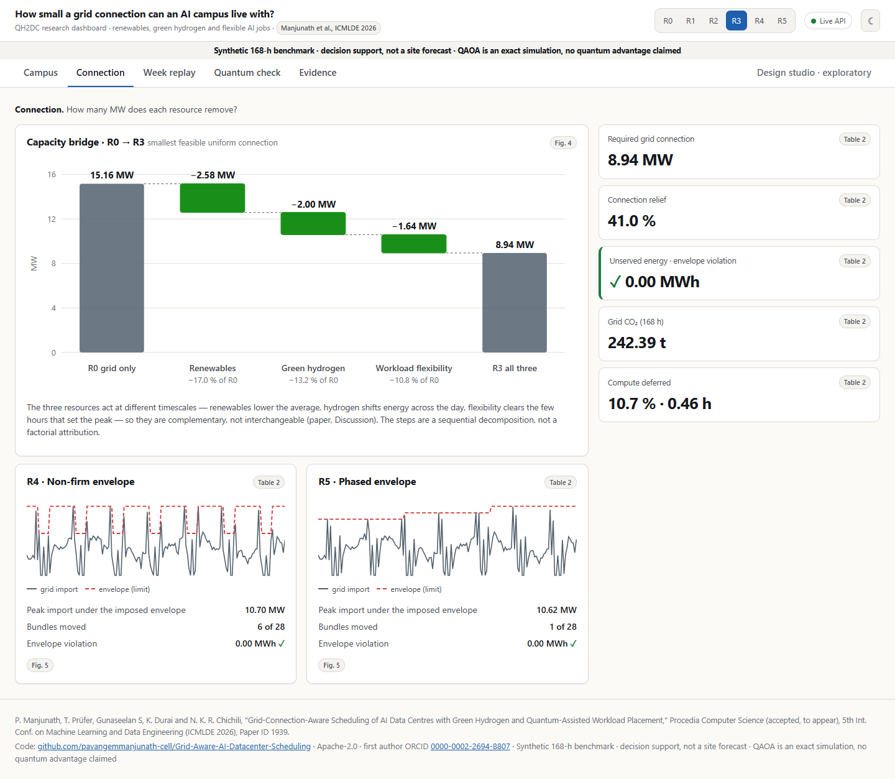
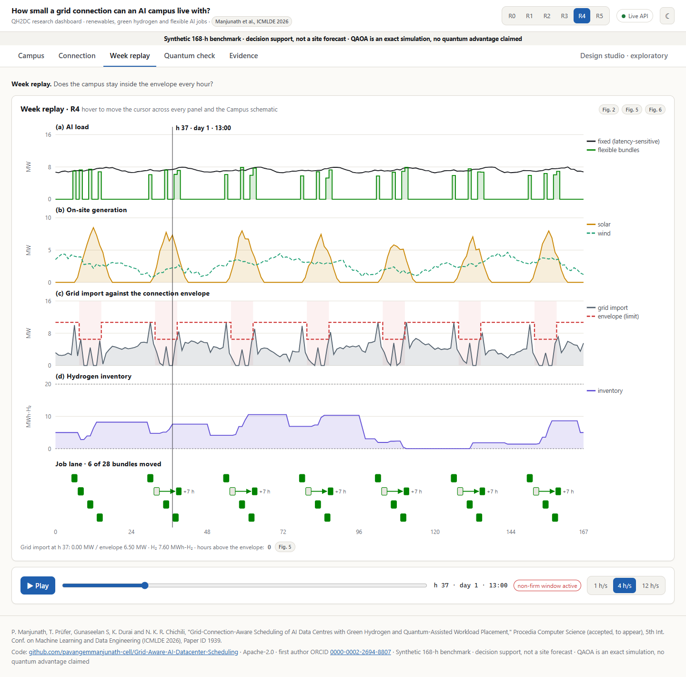
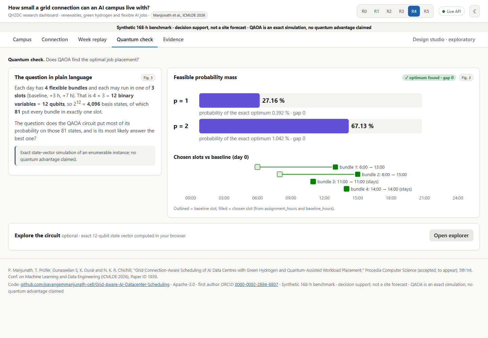
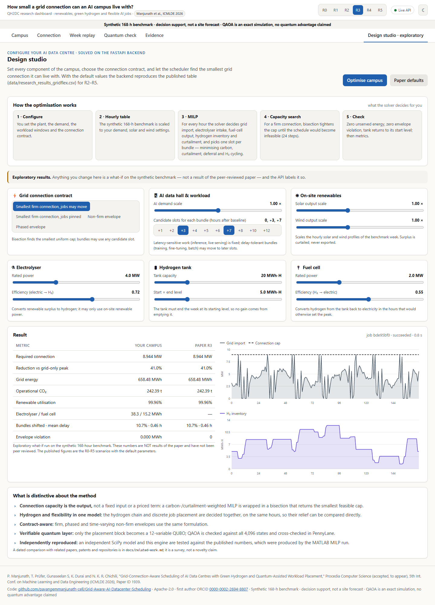

# QH2DC research dashboard — AI data-centre simulation

A dashboard that answers one question: **how small a grid connection can an AI campus live with, and how many
megawatts does each resource buy?** It turns the ICMLDE 2026 study (Manjunath et al., Paper ID 1939) into a
tool that answers that question in under a minute, with every number traceable to the paper and to a CSV column.



> **Synthetic 168-h benchmark · decision support, not a site forecast · QAOA is an exact simulation, no quantum
> advantage claimed.** This banner is fixed on every view.

## Who it is for

| User | Question they bring | What they leave with |
|---|---|---|
| AI campus developer / energy lead | Can I energise earlier on a smaller or non-firm connection? | MW saved by renewables, hydrogen and job shifting; zero unserved energy |
| Grid operator planner (DSO/TSO) | Will this load stay inside a time-varying envelope? | Hour-by-hour import against the envelope; count of violations |
| Researcher or reviewer | Can I trace and reproduce every number? | Each number linked to its paper table or figure and its CSV column |

## Views

| View | Question it answers | Main elements | Paper anchor |
|---|---|---|---|
| **Campus** (landing) | What is happening on site at this hour, and what does it add up to? | Component schematic (9 nodes, 9 edges), five KPI cards, hour scrubber (0–167, 1/4/12 h/s), ask-the-component card | Fig. 1, Table 2 |
| **Connection** | How many MW does each resource remove? | Capacity bridge 15.16 → 8.94 MW computed from the API; R4/R5 envelope checks | Fig. 4, Table 2 |
| **Week replay** | Does the campus stay inside the envelope every hour? | Four stacked 168-h panels with a shared cursor; job lane with +3/+7 h moves | Figs. 2, 5, 6 |
| **Quantum check** | Does QAOA find the optimal job placement? | 12 qubits, 4,096 states, 81 feasible; feasible mass at p = 1, 2; chosen vs baseline slots; optional circuit explorer | Fig. 3 |
| **Evidence** | Where does each number come from, and what are the limits? | Method, assumptions (from the API), downloads, citation + QR code, related work, candidate datasets | Secs. 3–8 |
| Design studio *(exploratory)* | What if I change the plant or the contract? | Configure every component and re-solve on the API; results labelled “not paper results” | — |

Design rules implemented: light paper-like style (dark optional); no geographic map; at most five KPIs per
screen; a citation chip on every KPI and chart; fixed colour meaning (grid slate, solar amber, wind teal, hydrogen
violet, flexible jobs green, connection limit red line), with every series also labelled or patterned; R4/R5
labelled **“Peak import under the imposed envelope”**; shareable URL state (`?view=…&scenario=R4&hour=37`).

| | |
|---|---|
|  |  |
|  |  |

## Read-only research API

The front end never computes results. Units are in field names (`_MW`, `_MWh`, `_t`); hours are integers 0–167;
`scenario` accepts R0–R5 only (anything else → **400**). Responses carry `Cache-Control: public, max-age=86400`
and an ETag derived from the model and data version (`If-None-Match` → 304).

| Endpoint | Returns | Source |
|---|---|---|
| `GET /api/meta` | title, authors, citation, model and data version, seed 20260430, solver, generator settings, assumptions, banner | `matlab/qh2dc_config.m`, data files |
| `GET /api/scenarios` | six rows: id, label, **kind** (`capacity_search` / `imposed_envelope`), capacity label, eight result fields | `data/research_results_gridflex.csv` |
| `GET /api/benchmark` | 168 hourly rows: loads, solar, wind, carbon, both envelopes, window flag | `data/research_benchmark_168h.csv` |
| `GET /api/dispatch?scenario=R3` | 168 hourly MILP rows: grid import, electrolyser, fuel cell, curtailment, H₂ inventory, envelope, flexible load | `data/dispatch/research_dispatch_<R>.csv` |
| `GET /api/jobs?scenario=R3` | 28 bundles: id, day, energy, baseline hour, chosen hour, delay | `data/dispatch/research_job_placement.csv` |
| `GET /api/qaoa` | states, feasible count, per-depth feasible mass, optimum probability, gap, chosen/baseline hours | `data/verification_summary.json` |
| `GET /api/components` | 9 nodes and 9 edges with ids, labels, kinds and the balance equation | model structure |
| `GET /api/components/{id}?scenario=&hour=` | value at the hour, 168-h series, week total, peak, share, limited hours, fields used | dispatch + benchmark files |
| `GET /api/download/{file}` | the published data files (whitelist) | `data/` |

Exploratory and interactive endpoints live under `/api/v1` (what-if simulations as asynchronous jobs, QAOA
evaluate/optimise, datasets, provenance, a disabled language-model assistant). Full schema at `/docs`; the
OpenAPI document is committed as `backend/openapi.json`. How the files behind these endpoints are produced is
described in [docs/data-pipeline.md](../docs/data-pipeline.md).

## Run

**Windows, one click:** `START.bat` in the repository root (first run installs everything), `STOP.bat` to stop.

**Any OS:**

```bash
# API on http://127.0.0.1:8000 (Swagger UI at /docs)
cd webapp/backend && python -m pip install -r requirements.txt && python -m uvicorn app.main:app --port 8000
# web app on http://localhost:5173 (proxies /api/ to the API)
cd webapp/frontend && npm ci && npm run dev
```

Without the API the app reads `public/api-snapshot/` — the exact API responses written by
`python -m app.snapshot` (run in `webapp/backend`) — and shows **API snapshot** in the header. The static build
(`npm run build` → `dist/`) can be hosted anywhere, e.g. GitHub Pages via `.github/workflows/pages.yml`.

## Tests

```bash
cd webapp/backend && python -m pytest          # 42 tests: engine parity, research API contract, v1 API
cd webapp/frontend && npm run build            # type-check + production build
cd webapp/frontend && npx playwright test      # 12 acceptance tests (Windows: set PW_CHANNEL=chrome to use installed Chrome)
```

## Language-model assistant (later)

The ask-the-component card answers four preset questions from the API and shows the endpoint and field each
answer came from. A free-text assistant can be added behind `webapp/backend/app/assistant/provider.py`; it must
answer only from these endpoints, name the field it used, and say “not in the model” otherwise
(see [ADR-0004](../docs/adr/0004-llm-behind-interface.md)).
